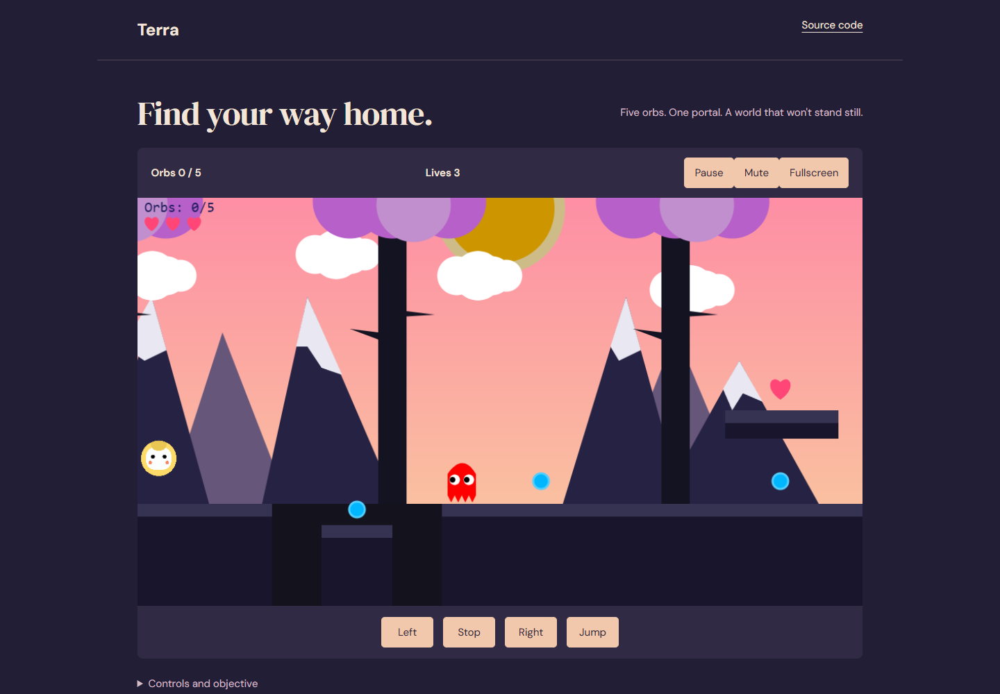

# Terra

A small platform game explores a moving landscape, collectible orbs and a gated portal. The refresh makes the objective, controls and game lifecycle visible.



## Demo

[Open the live demo](https://bharath-raj-official.github.io/terra/). Local setup is also available below.

## What it does

- Title/loading, pause, game-over and completion overlays; DOM lives/orbs HUD.
- Mute, fullscreen and touch movement/jump buttons. Audio starts after an intentional interaction.
- Shared restart rebuilds sprites, collectibles, hazards, hearts, gates and level flags.
- Stable 1024×576 world coordinates with CSS scaling.
- Compatibility repairs for the supplied Code.org p5.play fork and upstream p5.

## Run locally

```sh
python -m http.server 8000 --bind 127.0.0.1
```

Open http://127.0.0.1:8000/ in a modern browser. Run the command inside this repository. Do not open `index.html` directly from disk: local datasets/model assets use HTTP. Python 3 is only a local static server; no application build is required.

## Controls

A/D move; release the key to stop, or press S. Space jumps. P pauses; Enter starts or restarts. Touch buttons provide the same actions. Collect five orbs, survive the hazards, pass the gate and reach the portal. Browser fullscreen availability varies.

## Architecture and decisions

`sketch.js` retains the supplied world, sprites, particles and collisions. `interface.js` synchronizes the HTML HUD and overlays and pauses sprite updates as well as rendering. `initGame()` creates the world; `resetGame()` clears all sprites and arrays before rebuilding it. Missing/unready sound buffers are skipped safely.

## Limitations

One level; desktop-first movement. Automated completion checks force state transitions and do not prove that every platform route is playable on every device. Fullscreen, listening quality and touch ergonomics need device review. The supplied game uses an old p5 dependency; compatibility changes to `p5.play.js` are marked in the source.

## Validation

Edge checks cover launch, freezing sprite positions during pause, game-over/completion screens, restart with three lives and five orbs, mute and phone layout. Source audio buffers loaded successfully. Hardware listening and a complete human playthrough remain.

## Third-party attribution

p5.js and Code.org p5.play: license notices in `third-party/`. Supplied asset comments credit Clipartmax, SeekPNG and Mixkit; the game-over sound filename is retained but its original license is not established by this snapshot. Verify asset redistribution terms before a public release; no new ownership claim is made.

